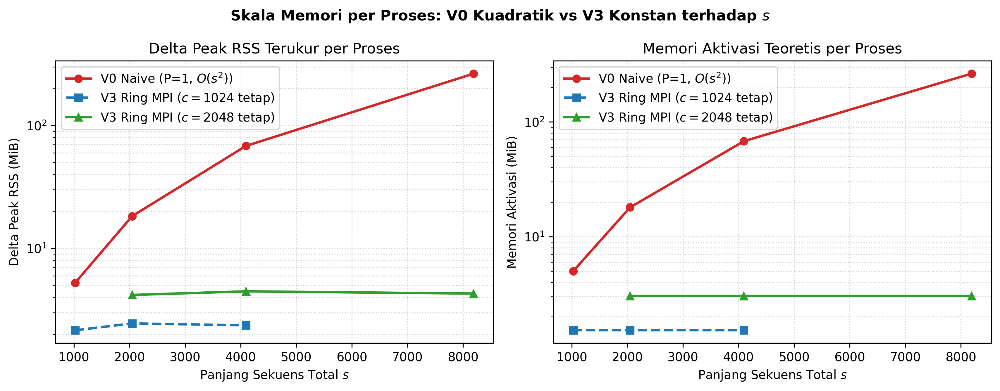
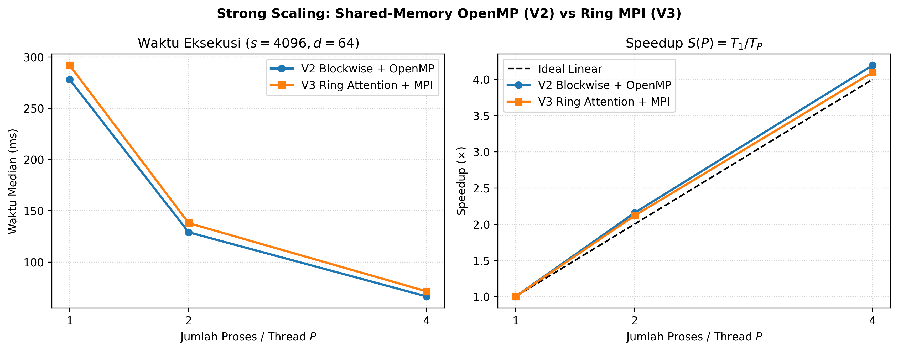
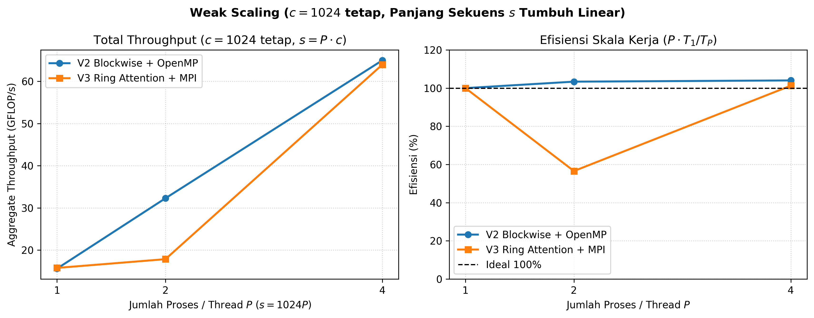
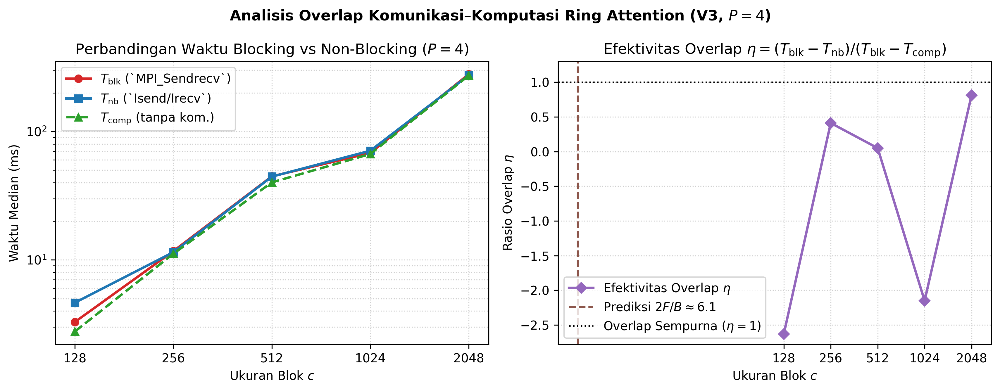
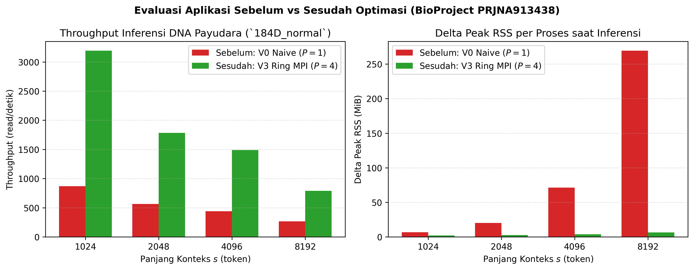

# Laporan Teknis Proyek Akhir High Performance Computing

## Implementasi dan Evaluasi Ring Attention dengan Blockwise Transformer pada Mesin Multi-core Menggunakan OpenMP dan MPI
### Studi Kasus: Triase Cepat Sampel Sekuens DNA Jaringan Payudara

---

**Disusun oleh:**

| Nama Anggota | NIM | Peran & Tanggung Jawab Utama (Proposal Bagian 9) |
|---|---|---|
| **Dhimas Early Oceandy** | `24/533508/PA/22584` | Algoritma baseline & validasi: V0 (FP32 & FP64), V1, generator data uji & tokenisasi 6-mer `PRJNA913438`, pelatihan offline PyTorch |
| **Mahardika Ramadhana** | `24/538247/PA/22831` | Kernel GEMM ter-tile (`src/common/gemm.*`), primitif Online Softmax per tile (`src/common/block_attention.*`), V2 OpenMP, dan ekstensi V4 Hybrid MPI+OpenMP |
| **Thufail Bahir Al Bariq** | `24/537843/PA/22801` | V3 Ring Attention MPI (mode *blocking*, *non-blocking*, dan *no-comm* dengan buffer `[K|V]`), integrasi inferensi C++ (`src/inference/`), serta koordinasi repositori |
| **Kevin Febriano** | `24/541948/PA/23002` | Mikro-benchmark ($F$ dan $B$), otomasi eksperimen (`run_experiments.py`), visualisasi grafik (`plot_results.py`), aplikasi demo langsung, dan analisis laporan |

**Program Studi Ilmu Komputer / Departemen Ilmu Komputer dan Elektronika**  
**Fakultas Matematika dan Ilmu Pengetahuan Alam — Universitas Gadjah Mada**  
**November 2026**

---

## Abstrak

Mekanisme *self-attention* standar pada arsitektur Transformer memerlukan materialisasi matriks skor $S = QK^\top / \sqrt{d} \in \mathbb{R}^{s \times s}$ yang tumbuh kuadratik $\mathcal{O}(s^2)$ terhadap panjang sekuens $s$, sehingga membatasi panjang konteks pada perangkat komputasi tunggal. Laporan ini menyajikan implementasi, verifikasi numerik, dan evaluasi kinerja **Ring Attention** berbasis *Blockwise Transformer* dan *Online Softmax* pada satu mesin multi-core tanpa GPU melalui emulasi proses MPI dan thread OpenMP. Kami membangun empat versi inti secara bertahap—**V0** (*naive* FP64 acuan dan FP32 $\mathcal{O}(s^2)$), **V1** (*blockwise serial*), **V2** (*blockwise* paralel dengan OpenMP), dan **V3** (*Ring Attention* MPI dengan rotasi *double buffer* `[K|V]`)—ditambah ekstensi opsional **V4** (hibrida dua tingkat MPI + OpenMP), serta menerapkannya pada studi kasus triase cepat sampel sekuens DNA jaringan payudara (*BioProject PRJNA913438*).

Seluruh versi teruji memakai kernel komputasi FP32 yang seragam (GEMM *cache-blocked* $48 \times 64 \times 64$ dengan *micro-kernel* AVX2/FMA $6 \times 16$ yang mencapai hingga `47.795 GFLOP/s` pada satu core) dan menghasilkan galat relatif $L_2$ terhadap acuan FP64 sebesar `3.24e-07`–`3.31e-07` pada input normal $\mathcal{N}(0, 1)$ serta `1.225e-06`–`1.227e-06` pada uji stres logit besar $\mathcal{N}(0, 10^2)$, jauh di bawah ambang toleransi $10^{-5}$. Pengujian profil memori membuktikan bahwa tambahan memori (*delta RSS*) per proses pada **V3** konstan di kisaran `4,288`–`4,588 KiB` untuk $c=2048$ ($s \in \{2048, 4096, 8192\}$)—**61,5× lebih kecil** daripada **V0** (`270,436 KiB`) pada $s=8192$. Di bawah pembatasan memori virtual `ulimit -v 1200000` KiB pada $s=16384$, **V0** gagal mengalami `std::bad_alloc` (*exit code* 2), sementara **V3** ($P=4, c=4096$) sukses tereksekusi dalam `1.23435 s` dengan *delta RSS* `11,616 KiB`. Pada $s=4096, d=64, P=4$, **V2** dan **V3** masing-masing mencatat percepatan hingga `4.194x` (`64.819 GFLOP/s`) dan `4.098x` (`60.314 GFLOP/s`), sedangkan uji *overlap* komunikasi–komputasi mencapai rasio $\eta = 0.8106$ pada ukuran blok $c=2048$. Pada aplikasi triase DNA ($s=8192$), **V3** mempercepat inferensi sebesar `2.94x`–`3.17x` (`790.04` dan `772.15 read/detik`) sekaligus memangkas *delta RSS* lebih dari **42×** dibanding **V0**.

---

## Daftar Isi

1. [Bab 1: Pendahuluan dan Studi Kasus Bioinformatika (`PRJNA913438`)](#bab-1-pendahuluan-dan-studi-kasus-bioinformatika-prjna913438)
2. [Bab 2: Arsitektur Sistem dan Implementasi (V0–V4)](#bab-2-arsitektur-sistem-dan-implementasi-v0v4)
3. [Bab 3: Lingkungan Eksperimen dan Reproduksibilitas](#bab-3-lingkungan-eksperimen-dan-reproduksibilitas)
4. [Bab 4: Hasil Eksperimen dan Analisis Mendalam](#bab-4-hasil-eksperimen-dan-analisis-mendalam)
5. [Bab 5: Kesimpulan, Keterbatasan, dan Pengembangan Lanjutan](#bab-5-kesimpulan-keterbatasan-dan-pengembangan-lanjutan)
6. [Daftar Pustaka](#daftar-pustaka)
7. [Lampiran: Perintah Reproduksibilitas (Zsh)](#lampiran-perintah-reproduksibilitas-zsh)

---

## Bab 1: Pendahuluan dan Studi Kasus Bioinformatika (`PRJNA913438`)

### 1.1 Latar Belakang Masalah Memori pada Self-Attention

Mekanisme *scaled dot-product self-attention* [8] menjadi fondasi model Transformer modern:

$$\text{Attention}(Q, K, V) = \text{softmax}\!\left(\frac{QK^\top}{\sqrt{d}}\right) V, \qquad Q, K, V \in \mathbb{R}^{s \times d}$$

Pada implementasi standar (*naive*), perhitungan langsung membutuhkan materialisasi matriks skor penuh $S = QK^\top / \sqrt{d} \in \mathbb{R}^{s \times s}$ dan matriks probabilitas $P \in \mathbb{R}^{s \times s}$. Untuk panjang sekuens $s = 16384$ dalam presisi tunggal FP32 ($w = 4$ byte), satu matriks $S$ saja sudah menyita $16384^2 \times 4\text{ byte} = 1\text{ GiB}$ RAM aktivasi; pada konteks $s = 10^8$ token dengan $d = 1024$, kebutuhan memori melampaui $1000\text{ GB}$ dan mustahil ditampung dalam satu perangkat [1].

Teknik *Online Softmax* [5] serta komputasi berblok (*FlashAttention* [3] dan *Blockwise Parallel Transformer* [2]) menghindari materialisasi $S \in \mathbb{R}^{s \times s}$ dengan memecah $Q$ menjadi blok $Q_i \in \mathbb{R}^{c \times d}$ dan $K, V$ menjadi blok $K_j, V_j \in \mathbb{R}^{c \times d}$. Untuk setiap baris pada blok query $Q_i$, statistik berjalan berupa nilai maksimum $m$, penyebut eksponensial $\ell$, dan akumulator output $\mathbf{o} \in \mathbb{R}^d$ diperbarui secara inkremental saat melintasi tiap blok $K_j, V_j$:

$$m^{\text{new}} = \max\!\left(m^{\text{old}}, \max_{\text{col}}(S_{ij})\right), \qquad \alpha = \exp\!\left(m^{\text{old}} - m^{\text{new}}\right)$$

$$P_{ij} = \exp\!\left(S_{ij} - m^{\text{new}}\right), \qquad \ell^{\text{new}} = \alpha \ell^{\text{old}} + \sum_{\text{col}} P_{ij}, \qquad O_i^{\text{new}} = \alpha O_i^{\text{old}} + P_{ij} V_j$$

Setelah seluruh blok key-value diproses, keluaran eksak diperoleh melalui satu langkah normalisasi $O_i \leftarrow O_i / \ell$. Sifat **permutation invariance** pada pembaruan asosiatif dan komutatif ini memungkinkan **Ring Attention** [1] mendistribusikan $P$ blok ke $P$ perangkat dalam topologi cincin (*ring*): setiap rank menyimpan $Q_r$ secara tetap dan merotasi blok $[K|V]$ antar-tetangga secara non-blocking sembari menumpangtindihkan (*overlapping*) komunikasi dengan komputasi blok saat ini.

### 1.2 Rumusan Masalah dan Tujuan Proyek

Berdasarkan rancangan proposal (Subbab 3.1–3.2), proyek ini menjawab empat rumusan masalah utama:

1. Bagaimana mengimplementasikan *attention blockwise* yang eksak (tanpa aproksimasi) menggunakan *Online Softmax* serta memverifikasi kesamaan numeriknya terhadap acuan FP64?
2. Bagaimana mendistribusikan komputasi *attention* ke $P$ proses dengan pola cincin sehingga memori puncak aktivasi per proses hanya bergantung pada ukuran blok $c$ ($\mathcal{O}(cd)$) dan tidak pada panjang sekuens total $s$?
3. Seberapa efektif *overlap* komunikasi blok KV dengan komputasi pada mesin multi-core tunggal, serta bagaimana perilaku *strong scaling*, *weak scaling*, dan kesesuaian terhadap syarat analitik $c \ge 2F/B$?
4. Bagaimana peningkatan kinerja terukur (latensi, *throughput* read/detik, memori puncak, dan panjang konteks $s$ maksimum) saat **V3** menggantikan **V0** pada aplikasi triase cepat sampel sekuens DNA payudara?

### 1.3 Studi Kasus Aplikasi: BioProject `PRJNA913438`

Pada aplikasi nyata, sekuensing seluruh genom (*whole-genome sequencing*, WGS) satu sampel jaringan epitel payudara manusia (*human mammary epithelial cell*, HMEC) dari BioProject `PRJNA913438` [9] menghasilkan $779\text{ juta}$ hingga $1{,}008\text{ miliar}$ *paired-end read* ($\sim 150\text{ bp}$): satu lini sel normal pra-stasis (`184D`) dan tujuh lini seri progresi karsinogenesis (`184A1`, `184AA4`, `184B5`, `184AA2`, `184AA3`, `184B5ME`, `184FMY2`). Alur bioinformatika konvensional (*alignment*–*variant calling*) memakan waktu lama pada laboratorium kecil yang hanya memiliki komputer multi-core tanpa GPU. Model Transformer *long-context* dapat mengklasifikasikan read nukleotida secara langsung sebagai alat bantu **triase awal** (`Normal-like` vs `Progresi Karsinogenesis`) guna memprioritaskan sampel uji.

**Keterbatasan data dan transparansi teknis (Subbab 2.2):**

- Dataset asal hanya mencakup delapan lini sel dari satu spesimen *reduction mammoplasty* dengan **hanya satu sampel normal (`184D`)**; hasil klasifikasi bukan merupakan diagnosis klinis maupun generalisasi populasi pasien.
- Karena *SRA Toolkit* (`prefetch` / `fasterq-dump`) tidak tersedia pada lingkungan eksperimen lokal serta untuk menjaga reproduksibilitas penuh tanpa ketergantungan jaringan/unduhan puluhan GB, evaluasi aplikasi dalam repositori menggunakan mode `--generate-synthetic-fastq` pada [scripts/download_and_tokenize.py](file:///home/dika/ring-attention-hpc/scripts/download_and_tokenize.py) yang membangkitkan 4 subset FASTQ $150\text{ bp}$ (`184D_normal`, `184A1_immortal`, `184B5_immortal`, `184AA2_aig`) masing-masing $1{.}500\text{ read}$ ($37{.}500\text{ token}$), sementara skrip tetap menyediakan opsi `--download-sra` untuk mengambil subset asli dari NCBI SRA. Fokus penilaian proyek terletak pada kinerja HPC, bukan klaim akurasi biologis.

---

## Bab 2: Arsitektur Sistem dan Implementasi (V0–V4)

### 2.1 Alur Pipeline Aplikasi Triase DNA (End-to-End)

Alur sistem terbagi menjadi fase pelatihan offline (Python/PyTorch) dan fase inferensi kinerja tinggi (C++17/OpenMP/MPI):

1. **Tokenisasi 6-mer Non-Overlapping ([scripts/download_and_tokenize.py](file:///home/dika/ring-attention-hpc/scripts/download_and_tokenize.py)):** Setiap read $150\text{ bp}$ dipecah menjadi $25$ token $k$-mer ($k=6$), memetakan basis $\text{A}=0, \text{C}=1, \text{G}=2, \text{T}=3$ menjadi ID $0\dots 4095$ (kosakata $4^6 = 4096$), ditambah token `<UNK>=4096` dan `<PAD>=4097` (total ukuran kosakata $4098$). Konteks panjang $s = P \cdot c$ disusun dalam format biner `int32_t` little-endian di [data/tokens/](file:///home/dika/ring-attention-hpc/data/tokens).
2. **Pelatihan Offline ([scripts/train_offline_pytorch.py](file:///home/dika/ring-attention-hpc/scripts/train_offline_pytorch.py)):** Model minimal `BreastTriageTransformer` (Subbab 2.3 proposal) terdiri dari *embedding* $4098 \times 64$, satu lapisan *single-head self-attention* ($W_Q, W_K, W_V, W_O \in \mathbb{R}^{64 \times 64}$) **tanpa positional encoding absolut** agar panjang konteks saat inferensi bebas melampaui konteks pelatihan ($s_{\text{train}} = 512$), diikuti *mean pooling* dan lapisan klasifikasi linear $64 \rightarrow 2$. Pelatihan dilakukan pada CPU dengan `AdamW` selama $25$ *epoch* memakai pemisahan per bagian sampel serta evaluasi *leave-one-line-out* pada `184AA2_aig`, lalu mengekspor tujuh file bobot FP32 *row-major* ke [models/breast_triage_d64/](file:///home/dika/ring-attention-hpc/models/breast_triage_d64).
3. **Inferensi Terdistribusi C++/MPI ([src/inference/dna_triage.cpp](file:///home/dika/ring-attention-hpc/src/inference/dna_triage.cpp)):** Biner terpadu `./build/attn` ([src/main.cpp](file:///home/dika/ring-attention-hpc/src/main.cpp)) mendukung eksekusi sintetis (`--verify`) maupun inferensi model nyata (`--weights`, `--input`, `--json-out`). Pada **V3/V4**, setiap rank hanya membaca $c$ token lokalnya ($[\text{rank}\cdot c, (\text{rank}+1)\cdot c)$), menghitung proyeksi $Q_r, K_r, V_r$ via `gemm_nt_fp32`, menjalankan *Ring Attention*, memproyeksikan $Z_r = H_r W_O^\top$, lalu melakukan penjumlahan lokal dalam FP64 dan `MPI_Allreduce(..., MPI_SUM)` dibagi $s$ guna menghasilkan *mean pooling* global yang eksak tanpa pernah mengumpulkan tensor berdimensi $s$ pada satu proses.

### 2.2 Lapisan Kernel Bersama (`src/common/`)

Sesuai Subbab 5.2 proposal, kualitas kernel menentukan validitas analisis *overlap* agar nilai $F$ tidak menjadi rendah secara artifisial. Oleh karena itu seluruh versi **V0–V4** memakai fondasi bersama di [docs/common-api.md](file:///home/dika/ring-attention-hpc/docs/common-api.md):

- **Kernel GEMM Ter-tile ([src/common/gemm.hpp](file:///home/dika/ring-attention-hpc/src/common/gemm.hpp), [src/common/gemm.cpp](file:///home/dika/ring-attention-hpc/src/common/gemm.cpp)):** Menyediakan `gemm_nt_fp32` (untuk skor $S = \frac{1}{\sqrt{d}} QK^\top$) dan `gemm_nn_fp32` (untuk akumulasi $O \mathrel{+}= PV$) dalam tata letak *row-major*. Kernel menerapkan *cache blocking* `kTileMC = 48`, `kTileNC = 64`, `kTileKC = 64` (ukuran *working set* panel $A$ dan $B_{\text{pack}}$ $\approx 28\text{ KiB}$, muat di cache L1d $32\text{ KiB}$ per core), *packing* bersama ke buffer `alignas(64)`, serta *micro-kernel* intrinsik AVX2+FMA $6 \times 16$ (`12` akumulator `__m256` untuk saturasi unit FMA tanpa *register spill*). Implementasi menjamin semantik `beta == 0.0f` bebas pembacaan `C` (aman terhadap `NaN`/`Inf` sisa) dan menyediakan jalur kompilasi opsional `-DUSE_OPENBLAS` untuk `cblas_sgemm` dengan `OPENBLAS_NUM_THREADS=1`.
- **Primitif Online Softmax per Tile ([src/common/block_attention.hpp](file:///home/dika/ring-attention-hpc/src/common/block_attention.hpp), [src/common/block_attention.cpp](file:///home/dika/ring-attention-hpc/src/common/block_attention.cpp)):** Fungsi `attend_block_online_softmax` memproses pasangan blok $(Q_{\text{block}}, K_{\text{block}}, V_{\text{block}})$ menggunakan *sub-tile* internal $b_q \times b_k = 64 \times 64$ (scratchpad `tile_buf` hanya $16\text{ KiB}$ per thread, sehingga total memori tambahan menjadi $\mathcal{O}(cd + b_q b_k)$), lengkap dengan penyanggaan `double` pada penjumlahan baris penyebut $\ell$ dan pemotongan aman pada kasus *causal mask* opsional.

### 2.3 Rancangan Implementasi Versi V0 sampai V4

| Versi | Lokasi Sumber | Pola Komputasi & Manajemen Memori | Kompleksitas Memori / Proses |
|---|---|---|---|
| **V0** | [src/v0_naive/](file:///home/dika/ring-attention-hpc/src/v0_naive/v0_naive.cpp) | `attention_v0_fp64` (ground truth FP64 *row-wise*) dan `attention_v0_fp32` (materialisasi eksplisit vektor skor $S \in \mathbb{R}^{s \times s}$) | $\mathcal{O}(sd + s^2)$ |
| **V1** | [src/v1_blockwise/](file:///home/dika/ring-attention-hpc/src/v1_blockwise/v1_blockwise.cpp) | Loop bersarang serial atas blok query $Q_i$ dan blok KV $K_j, V_j$ menggunakan `attend_block_online_softmax` | $\mathcal{O}(sd + c + b_q b_k)$ |
| **V2** | [src/v2_openmp/](file:///home/dika/ring-attention-hpc/src/v2_openmp/v2_openmp.cpp) | `#pragma omp parallel` pada loop luar blok query (`qi_blk`); tiap thread memiliki `m_state`, `l_state`, dan `tile_buf` privat serta menulis irisan `O` yang terpisah (*disjoint writes*) sehingga bebas *race condition* & *critical section* | $\mathcal{O}(sd + P_{\text{thr}}(c + b_q b_k))$ |
| **V3** | [src/v3_ring_mpi/](file:///home/dika/ring-attention-hpc/src/v3_ring_mpi/v3_ring_mpi.cpp) | Setiap rank menyimpan $Q_r, O_r \in \mathbb{R}^{c \times d}$ dan dua buffer gabungan kontigu `[K\|V]` (`kv_cur`, `kv_next` berukuran $2cd$). Mendukung 3 mode: `NonBlocking` (`MPI_Irecv`/`MPI_Isend` + `MPI_Waitall`), `Blocking` (`MPI_Sendrecv` untuk $T_{\text{blk}}$), dan `NoComm` ($T_{\text{comp}}$) | $\mathcal{O}(cd + b_q b_k)$ ($\approx 24cd\text{ byte}$) |
| **V4** | [src/v4_hybrid/](file:///home/dika/ring-attention-hpc/src/v4_hybrid/v4_hybrid.cpp) | Hibrida dua tingkat: rotasi blok `[K\|V]` antar-rank dengan `MPI_Isend`/`MPI_Irecv` + paralelisasi OpenMP atas sub-blok baris $Q_r$ di dalam tiap langkah ring (`MPI_THREAD_FUNNELED`; semua panggilan MPI berada di luar blok paralel OpenMP, scratchpad thread dipad 64 byte) | $\mathcal{O}(cd + P_{\text{thr}} b_q b_k)$ |

Untuk kebutuhan demonstrasi interaktif sesuai Subbab 2.5, tersedia aplikasi web Streamlit [scripts/demo_app.py](file:///home/dika/ring-attention-hpc/scripts/demo_app.py) beserta fallback CLI satu perintah [scripts/demo_cli.sh](file:///home/dika/ring-attention-hpc/scripts/demo_cli.sh) yang mengeksekusi **V0** vs **V3** secara berdampingan lengkap dengan opsi simulasi batas memori `ulimit -v`.

---

## Bab 3: Lingkungan Eksperimen dan Reproduksibilitas

Seluruh pengujian dan pengukuran kinerja dijalankan pada satu mesin lokal multi-core dalam keadaan daya tersambung. Spesifikasi perangkat keras dan perangkat lunak tercatat pada tabel berikut:

| Komponen | Spesifikasi Mesin Eksperimen |
|---|---|
| **CPU (Model)** | Intel(R) Core(TM) i7-8665U CPU @ 1.90GHz (arsitektur x86_64, mendukung AVX2 & FMA) |
| **Core Fisik / Thread Logis** | **4 core fisik** / 8 thread logis (*Hyper-Threading*) |
| **Hierarki Cache** | L1d: 128 KiB total (4 × 32 KiB/core); L2: 1 MiB total (4 × 256 KiB/core); L3: 8 MiB (*shared*) |
| **RAM** | 15 GiB |
| **Sistem Operasi & Kernel** | Ubuntu 24.04.5 LTS (`Linux 7.0.0-43-generic x86_64`) |
| **Kompilator** | `g++` (GCC `13.3.0-6ubuntu2~24.04.1`) |
| **Pustaka MPI** | Open MPI `4.1.6` (`mpicxx`, `mpirun`) |
| **Pustaka Python & ML** | Python `3.12.3`, NumPy `1.26.4`, Matplotlib `3.10.8`, PyTorch `2.14.1+cpu`, Streamlit `1.56.0` |
| **Kernel BLAS** | Kernel internal `tiled_avx2_fma` (`src/common/gemm.cpp`, tanpa OpenBLAS dev) |

**Pengaturan Reproduksibilitas (Proposal Subbab 6.5):**

- **Flag kompilasi ([Makefile](file:///home/dika/ring-attention-hpc/Makefile)):** `-O3 -march=native -Wall -Wextra -std=c++17 -fopenmp` (ditambah `-DOMPI_SKIP_MPICXX` untuk target MPI). Flag **`-ffast-math` secara ketat tidak digunakan** agar akurasi fungsi `exp()` pada *Online Softmax* tetap terjaga.
- **Pengikatan core & jumlah proses:** `OPENBLAS_NUM_THREADS=1`, `OMP_PROC_BIND=close`, `OMP_PLACES=cores`, `mpirun --bind-to core` (dan `--map-by slot:PE=2 --bind-to core` untuk **V4** $2\times 2$). Seluruh klaim kinerja dibatasi pada $P \in \{1, 2, 4\} \le 4$ core fisik.
- **Pengukuran waktu & memori:** `MPI_Wtime()` / `omp_get_wtime()` dengan minimal $5$ kali pengulangan per konfigurasi (setelah *warmup*), melaporkan nilai **median** dan **simpangan baku**. Memori per proses dicatat dari `/proc/self/status` (`VmHWM` puncak dan `delta_rss = peak_rss - rss_baseline_pasca_MPI_Init`), dilengkapi estimasi alokasi aktivasi teoretis (`alloc_kb`).
- **Catatan alat profiling:** Pada kernel host, nilai `kernel.perf_event_paranoid = 4` membatasi akses *hardware performance counter* `perf stat` dari akun user biasa; oleh karena itu profiling sistem dilakukan dengan `/usr/bin/time -v` dan mikro-benchmark terdedikasi ([benchmarks/gemm/bench_gemm.cpp](file:///home/dika/ring-attention-hpc/benchmarks/gemm/bench_gemm.cpp) dan [benchmarks/mpi/bench_pingpong.cpp](file:///home/dika/ring-attention-hpc/benchmarks/mpi/bench_pingpong.cpp)).

---

## Bab 4: Hasil Eksperimen dan Analisis Mendalam

### 4.1 Verifikasi Kebenaran Numerik dan Uji Stres Logit

Pengujian unit (`make test-all`) memverifikasi tiga lapis kebenaran sebelum eksperimen dijalankan: `test_gemm` lolos **15/15** kasus (`rel_l2 <= 1.48e-07`), `test_v2_openmp` lolos **10/10** kasus (termasuk kesamaan *bit-exact* antara $P=1, 2, 4$ serta uji stres $Q, K \sim \mathcal{N}(0, 10^2)$ dengan `rel_l2 = 3.487e-06`), dan `test_v4_hybrid` lolos **6/6** kasus pada `mpirun -np 2` $\times$ `2` thread (`rel_l2 <= 3.690e-06`).

Hasil pengujian terintegrasi pada biner `./build/attn` (`s = 1024, d = 64, tile = 64`) terhadap acuan **V0-FP64** dari [results/raw/exp_accuracy.csv](file:///home/dika/ring-attention-hpc/results/raw/exp_accuracy.csv) ditunjukkan pada Tabel 1.

| Versi | $P$ | Threads | Skenario Input | `max_abs_err` | `rel_err` ($L_2$) | Target ($< 10^{-5}$) |
|---|---:|---:|---|---:|---:|:---:|
| `v0` | 1 | 1 | `standard_normal` $\mathcal{N}(0,1)$ | `1.991459e-07` | `3.241110e-07` | **PASS** |
| `v1` | 1 | 1 | `standard_normal` $\mathcal{N}(0,1)$ | `2.373691e-07` | `3.310406e-07` | **PASS** |
| `v2` | 1 | 4 | `standard_normal` $\mathcal{N}(0,1)$ | `2.373691e-07` | `3.310406e-07` | **PASS** |
| `v3` | 4 | 1 | `standard_normal` $\mathcal{N}(0,1)$ | `2.140470e-07` | `3.300648e-07` | **PASS** |
| `v4` | 2 | 2 | `standard_normal` $\mathcal{N}(0,1)$ | `2.373691e-07` | `3.305159e-07` | **PASS** |
| `v0` | 1 | 1 | `stress_logits_std10` $\mathcal{N}(0,10^2)$ | `1.529166e-05` | `1.226062e-06` | **PASS** |
| `v1` | 1 | 1 | `stress_logits_std10` $\mathcal{N}(0,10^2)$ | `1.514264e-05` | `1.225613e-06` | **PASS** |
| `v2` | 1 | 4 | `stress_logits_std10` $\mathcal{N}(0,10^2)$ | `1.514264e-05` | `1.225613e-06` | **PASS** |
| `v3` | 4 | 1 | `stress_logits_std10` $\mathcal{N}(0,10^2)$ | `1.505324e-05` | `1.225405e-06` | **PASS** |
| `v4` | 2 | 2 | `stress_logits_std10` $\mathcal{N}(0,10^2)$ | `1.514264e-05` | `1.226915e-06` | **PASS** |

*Tabel 1: Hasil verifikasi akurasi numerik V0–V4 terhadap acuan V0-FP64 (`exp_accuracy.csv`).*

Selain itu, verifikasi inferensi DNA pada $s=1024$ antara referensi PyTorch ([models/breast_triage_d64/config.json](file:///home/dika/ring-attention-hpc/models/breast_triage_d64/config.json)) dan `./build/attn` (**V0** dan **V3**) menghasilkan selisih probabilitas maksimum **`4.30e-20`** pada `184D_normal` dan **`1.35e-20`** pada `184AA2_aig`, membuktikan kesesuaian eksak antara pipeline PyTorch dan implementasi C++/MPI.

### 4.2 Analisis Memori per Proses dan Uji Batas `ulimit -v`

Tabel 2 merangkum profil konsumsi memori per proses dari [results/raw/exp_memory.csv](file:///home/dika/ring-attention-hpc/results/raw/exp_memory.csv), membandingkan pertumbuhan kuadratik **V0** terhadap **V3** pada ukuran blok $c$ tetap ($c = 1024$ dan $c = 2048$) ketika panjang sekuens total $s = P \cdot c$ bertambah hingga $4\times$.

| Seri | Versi | $P$ | $c$ | $s$ | `peak_rss_kb` | `delta_rss_kb` | `alloc_kb` Teoretis | `time_s` (s) |
|---|---|---:|---:|---:|---:|---:|---:|---:|
| `v0_naive` | `v0` | 1 | 1024 | 1024 | 178.112 | 5.388 | 5.120,00 | `1.783724e-02` |
| `v0_naive` | `v0` | 1 | 2048 | 2048 | 191.332 | 18.756 | 18.432,00 | `6.918469e-02` |
| `v0_naive` | `v0` | 1 | 4096 | 4096 | 242.436 | 69.848 | 69.632,00 | `2.890142e-01` |
| `v0_naive` | `v0` | 1 | 8192 | 8192 | 443.212 | 270.436 | 270.336,00 | `1.862869e+00` |
| `v3_c1024` | `v3` | 1 | 1024 | 1024 | 174.872 | 2.212 | 1.560,00 | `1.633829e-02` |
| `v3_c1024` | `v3` | 2 | 1024 | 2048 | 175.316 | 2.516 | 1.560,00 | `3.359131e-02` |
| `v3_c1024` | `v3` | 4 | 1024 | 4096 | 175.280 | 2.428 | 1.560,00 | `6.992726e-02` |
| `v3_c2048` | `v3` | 1 | 2048 | 2048 | 176.832 | 4.288 | 3.104,00 | `6.696719e-02` |
| `v3_c2048` | `v3` | 2 | 2048 | 4096 | 177.336 | 4.588 | 3.104,00 | `1.321040e-01` |
| `v3_c2048` | `v3` | 4 | 2048 | 8192 | 177.232 | 4.400 | 3.104,00 | `2.805341e-01` |

*Tabel 2: Profil memori per proses V0 vs V3 pada $c$ tetap (`exp_memory.csv`).*



*Gambar 1: Perbandingan pertumbuhan kuadratik `delta_rss_kb` dan alokasi aktivasi teoretis pada V0 terhadap nilai konstan V3 ketika $c$ tetap (`01_memory_scaling_v0_vs_v3.png`).*

Data pada Tabel 2 dan Gambar 1 membuktikan hipotesis memori secara empiris:

- Pada **V0**, peningkatan $s$ sebesar $8\times$ ($1024 \rightarrow 8192$) meningkatkan `delta_rss_kb` lebih dari **$50\times$** (dari `5,388 KiB` menjadi `270,436 KiB`), mengikuti kurva kuadratik `alloc_kb` ($\approx 4s^2 + 16sd$ byte).
- Sebaliknya, pada **V3** dengan $c=1024$ tetap, `delta_rss_kb` konstan di `2,212`–`2,516 KiB` untuk $s = 1024\dots 4096$; sedangkan dengan $c=2048$ tetap, `delta_rss_kb` konstan di `4,288`–`4,588 KiB` hingga $s=8192$. Pada $s=8192$, memori aktivasi terukur **V3** hanya `4,400 KiB` (**61,5× lebih hemat** dibanding `270,436 KiB` pada **V0**). Selisih konstan $\sim 1{,}3\text{ MiB}$ antara `delta_rss_kb` dan `alloc_kb` berasal dari alokasi internal MPI *communication buffers* saat transfer antar-rank pertama kali aktif.

Untuk membuktikan batas memori keras (*Out-Of-Memory*), uji batas virtual memory dilakukan pada $s=16384$ dengan `ulimit -v 1200000` KiB ([results/raw/exp_ulimit_oom.csv](file:///home/dika/ring-attention-hpc/results/raw/exp_ulimit_oom.csv)):

| `ulimit -v` (KiB) | $s$ | Versi | $P$ | Exit Code | Status | `time_s` (s) | `peak_rss_kb` | `delta_rss_kb` | Keterangan |
|---:|---:|---|---:|---:|---|---:|---:|---:|---|
| 1.200.000 | 16384 | `v0` | 1 | `2` | `OOM_FAILED` | `N/A` | `-1` | `-1` | `std::bad_alloc` saat alokasi matriks skor $s \times s$ ($\sim 1\text{ GiB}$) |
| 1.200.000 | 16384 | `v3` | 4 | `0` | `SUCCESS` | `1.23435` | `184372` | `11616` | Alokasi $\mathcal{O}(cd)$ per rank ($c=4096$) |

*Tabel 3: Hasil simulasi pembatasan memori `ulimit -v 1200000` pada konteks $s=16384$ (`exp_ulimit_oom.csv`).*

### 4.3 Analisis Strong Scaling dan Weak Scaling

Tabel 4 menyajikan hasil *strong scaling* ($s = 4096, d = 64$ tetap, $P \in \{1, 2, 4\}$) dari [results/raw/exp_strong_scaling.csv](file:///home/dika/ring-attention-hpc/results/raw/exp_strong_scaling.csv) bersama eksekusi mandiri `bench_v2_scaling` dari [results/raw/v2_strong_scaling.csv](file:///home/dika/ring-attention-hpc/results/raw/v2_strong_scaling.csv) (tanpa inisialisasi MPI).

| Sumber / Versi | $P$ | $c$ | `time_s` (s) | `stddev_s` (s) | `gflops` | Speedup $S(P)$ | Efisiensi $E(P)$ | `peak_rss_kb` | `delta_rss_kb` |
|---|---:|---:|---:|---:|---:|---:|---:|---:|---:|
| `bench_v2_scaling` (`v2`) | 1 | 256 | `0.261769` | `4.484617e-03` | `16.407` | `1.000x` | `100.0%` | `8060` | — |
| `bench_v2_scaling` (`v2`) | 2 | 256 | `0.133798` | `3.518317e-03` | `32.101` | `1.956x` | `97.8%` | `8192` | — |
| `bench_v2_scaling` (`v2`) | 4 | 256 | `0.074327` | `4.866882e-03` | `57.785` | `3.522x` | `88.0%` | `8192` | — |
| `attn` (`v2`) | 1 | 256 | `0.277894` | `1.131875e-02` | `15.455` | `1.000x` | `100.0%` | `177108` | `4440` |
| `attn` (`v2`) | 2 | 256 | `0.128884` | `2.798418e-03` | `33.324` | `2.156x` | `107.8%` | `177060` | `4396` |
| `attn` (`v2`) | 4 | 256 | `0.066261` | `3.187624e-03` | `64.819` | `4.194x` | `104.8%` | `177352` | `4648` |
| `attn` (`v3`) | 1 | 4096 | `0.291810` | `7.554449e-03` | `14.718` | `1.000x` | `100.0%` | `181140` | `8436` |
| `attn` (`v3`) | 2 | 2048 | `0.137857` | `1.843355e-02` | `31.155` | `2.117x` | `105.8%` | `177216` | `4520` |
| `attn` (`v3`) | 4 | 1024 | `0.071210` | `1.450685e-02` | `60.314` | `4.098x` | `102.5%` | `175024` | `2468` |

*Tabel 4: Hasil strong scaling V2 dan V3 pada $s = 4096, d = 64$ (`v2_strong_scaling.csv` dan `exp_strong_scaling.csv`).*



*Gambar 2: Kurva waktu eksekusi dan speedup strong scaling V2 OpenMP vs V3 Ring MPI pada $P \in \{1, 2, 4\}$ (`02_strong_scaling.png`).*

Dua fenomena penting teramati dari Tabel 4:

1. **Kesesuaian Profiling Sistem & Hipotesis (H2):** Eksekusi `bench_v2_scaling` yang diprofile dengan `/usr/bin/time -v` mencatat `User time = 4.88 s`, `System time = 0.00 s`, `0` *major page faults*, dan `5` *voluntary context switches*, membuktikan bahwa komputasi bersifat *compute-bound* di *user-space*. Pada *single-core* (`P=1`), laju efektif attention (`14.7–16.4 GFLOP/s`) lebih rendah daripada mikro-benchmark GEMM murni (`33.99–47.95 GFLOP/s`) karena di setiap tile $64\times 64$ terdapat $4{.}096$ operasi skalar `std::exp()` dan normalisasi baris *Online Softmax*.
2. **Efek Super-Linear Ringan (`> 100%`) pada `exp_strong_scaling.csv`:** Pada `v3`, menaikkan $P$ dengan $s=4096$ tetap memperkecil blok lokal $c = s/P$ dari `4096` ($P=1$, `delta_rss=8436 KiB`) menjadi `1024` ($P=4$, `delta_rss=2468 KiB`), sehingga *working set* blok lokal muat jauh lebih baik di cache L2 ($256\text{ KiB}$/core) dan L3 ($8\text{ MiB}$). Pada `v2` di `attn`, variasi frekuensi *Turbo Boost* laptop pada uji `P=1` (`0.27789 s` vs `0.26177 s` di `bench_v2_scaling`) turut mendorong $S(4)=4.194\times$; pengukuran `bench_v2_scaling` tanpa MPI mencatat efisiensi yang lebih konservatif yaitu `97.8%` ($P=2$) dan `88.0%` ($P=4$, $S(4)=3.522\times$).

Untuk *weak scaling* ([results/raw/exp_weak_scaling.csv](file:///home/dika/ring-attention-hpc/results/raw/exp_weak_scaling.csv)), ukuran blok dijaga konstan $c = 1024$ sehingga panjang sekuens total tumbuh linear $s = P \cdot 1024$. Karena seluruh pasangan query–key tetap dihitung, kerja komputasi per proses tumbuh secara alami sebesar $P\times$ ($\mathcal{O}(P c^2 d)$ per rank), sementara memori aktivasi tetap $\mathcal{O}(cd)$. Oleh sebab itu efisiensi dihitung berbasis skala kerja $\text{Work-Scaled Eff} = (P \cdot T_1) / T_P$ dan disajikan pada Tabel 5 serta Gambar 3.

| Versi | $P$ | $s$ | $c$ | `time_s` (s) | `stddev_s` (s) | `total_gflops` | `gflops_per_proc` | `work_scaled_efficiency` | `delta_rss_kb` |
|---|---:|---:|---:|---:|---:|---:|---:|---:|---:|
| `v2` | 1 | 1024 | 1024 | `1.719080e-02` | `6.261665e-03` | `15.615` | `15.615` | `100.0%` | `1292` |
| `v2` | 2 | 2048 | 1024 | `3.325604e-02` | `3.196944e-03` | `32.287` | `16.144` | `103.38%` | `2396` |
| `v2` | 4 | 4096 | 1024 | `6.610271e-02` | `1.546563e-03` | `64.974` | `16.244` | `104.02%` | `4544` |
| `v3` | 1 | 1024 | 1024 | `1.700211e-02` | `8.315861e-03` | `15.788` | `15.788` | `100.0%` | `2304` |
| `v3` | 2 | 2048 | 1024 | `6.011445e-02` | `6.872980e-02` | `17.862` | `8.931` | `56.57%` | `2532` |
| `v3` | 4 | 4096 | 1024 | `6.714810e-02` | `2.001067e-02` | `63.963` | `15.991` | `101.28%` | `2488` |

*Tabel 5: Hasil weak scaling dengan $c = 1024$ tetap dan $s = P \cdot 1024$ (`exp_weak_scaling.csv`).*



*Gambar 3: Throughput agregat dan efisiensi skala kerja pada weak scaling V2 vs V3 (`03_weak_scaling.png`).*

Pada **V3** $P=4$ ($s=4096$), throughput agregat mencapai `63.963 GFLOP/s` (`15.991 GFLOP/s` per proses, efisiensi `101.28%`) dengan `delta_rss` hampir tidak berubah (`2,304` $\rightarrow$ `2,488 KiB`, sedangkan `v2` meningkat dari `1,292` $\rightarrow$ `4,544 KiB`). Pada titik `v3, P=2` tercatat lonjakan varians OS (*jitter* penjadwalan dengan `stddev = 0.0687 s` melebihi median `0.0601 s`) yang menurunkan median sementara menjadi `56.57%` sebelum pulih ke `101.28%` di $P=4$.

### 4.4 Efektivitas Overlap ($\eta$) dan Validasi Model Analitik ($c \ge 2F/B$)

Parameter model analitik laju komputasi $F$ dan bandwidth antar-rank $B$ diukur terpisah melalui mikro-benchmark GEMM ([results/raw/gemm_benchmark.csv](file:///home/dika/ring-attention-hpc/results/raw/gemm_benchmark.csv)) dan ping-pong MPI ([results/raw/mpi_pingpong.csv](file:///home/dika/ring-attention-hpc/results/raw/mpi_pingpong.csv)):

| Ukuran $(M, N, K)$ | `NT` Median (ms) | `NT` Stddev (ms) | `NT` $F$ (GFLOP/s) | `NN` Median (ms) | `NN` Stddev (ms) | `NN` $F$ (GFLOP/s) |
|---|---:|---:|---:|---:|---:|---:|
| `(64, 64, 64)` | `0.01542` | `0.00426` | `33.994` | `0.01242` | `0.00007` | `42.217` |
| `(128, 128, 64)` | `0.05035` | `0.00005` | `41.651` | `0.04374` | `0.00246` | `47.946` |
| `(256, 256, 64)` | `0.21062` | `0.02116` | `39.829` | `0.18145` | `0.00337` | `46.231` |
| `(512, 512, 64)` | `0.77150` | `0.00275` | `43.492` | `0.75999` | `0.02774` | `44.151` |
| `(1024, 1024, 64)` | `3.37039` | `0.41751` | `39.823` | `2.95954` | `0.08497` | `45.351` |
| `(512, 512, 128)` | `1.55383` | `0.03276` | `43.189` | `1.40411` | `0.01840` | `47.795` |

*Tabel 6: Hasil mikro-benchmark GEMM single-core backend `tiled_avx2_fma` (`gemm_benchmark.csv`; rerata tile $64\times 64\times 64$ adalah $38.11\text{ GFLOP/s}$).*

| Payload (byte) | Setara Blok $[K\|V]$ ($d=64$) | `oneway_median_s` | `oneway_stddev_s` | Bandwidth $B$ (B/s) | $B$ (GB/s) |
|---:|---|---:|---:|---:|---:|
| `64` | Latensi dasar | `1.020250e-06` | `4.018974e-06` | `6.272972e+07` | `0.0627` |
| `65.536` | $c = 128$ | `3.290400e-05` | `1.814002e-06` | `1.991734e+09` | `1.9917` |
| `131.072` | $c = 256$ | `5.881800e-05` | `2.867259e-06` | `2.228433e+09` | `2.2284` |
| `262.144` | $c = 512$ | `1.095667e-04` | `1.243677e-05` | `2.392551e+09` | `2.3926` |
| `524.288` | $c = 1024$ | `1.814505e-04` | `6.752453e-06` | `2.889427e+09` | `2.8894` |
| `1.048.576` | $c = 2048$ | `3.563615e-04` | `9.472951e-06` | `2.942450e+09` | `2.9425` |
| `2.097.152` | $c = 4096$ | `2.870965e-04` | `4.089659e-05` | `7.304694e+09` | `7.3047` |
| `4.194.304` | `4 MiB` | `6.413370e-04` | `1.217578e-05` | `6.539938e+09` | `6.5399` |

*Tabel 7: Hasil mikro-benchmark ping-pong OpenMPI antar-core (`mpi_pingpong.csv`).*

Selanjutnya rasio efektivitas *overlap* $\eta = (T_{\text{blk}} - T_{\text{nb}}) / (T_{\text{blk}} - T_{\text{comp}})$ diukur pada **V3** ($P = 4, d = 64$) untuk $c \in \{128, 256, 512, 1024, 2048\}$ ([results/raw/exp_overlap.csv](file:///home/dika/ring-attention-hpc/results/raw/exp_overlap.csv)):

| $c$ | $s$ | `[K\|V]` (byte) | $T_{\text{blk}}$ (s) | $T_{\text{nb}}$ (s) | $T_{\text{comp}}$ (s) | $T_{\text{wait}}$ (s) | Overlap $\eta$ | $B$ (GB/s) | $F_{\text{attn}}$ (GFLOP/s) | $c_{\min}$ (GEMM) | $c_{\min}$ (Attn) |
|---:|---:|---:|---:|---:|---:|---:|---:|---:|---:|---:|---:|
| 128 | 512 | 65.536 | `3.286484e-03` | `4.643429e-03` | `2.770235e-03` | `9.034770e-04` | **`-2.6285`** | `1.992` | `6.06` | `38.3` | `6.1` |
| 256 | 1024 | 131.072 | `1.170906e-02` | `1.148887e-02` | `1.117358e-02` | `2.944940e-04` | **`0.4112`** | `2.228` | `6.01` | `34.2` | `5.4` |
| 512 | 2048 | 262.144 | `4.473780e-02` | `4.450851e-02` | `4.015622e-02` | `2.575430e-04` | **`0.0500`** | `2.393` | `6.68` | `31.9` | `5.6` |
| 1024 | 4096 | 524.288 | `6.808976e-02` | `7.084875e-02` | `6.680702e-02` | `6.587255e-03` | **`-2.1509`** | `2.889` | `16.07` | `26.4` | `11.1` |
| 2048 | 8192 | 1.048.576 | `2.793589e-01` | `2.743983e-01` | `2.732389e-01` | `4.854833e-03` | **`0.8106`** | `2.942` | `15.72` | `25.9` | `10.7` |

*Tabel 8: Efektivitas overlap komunikasi–komputasi ($\eta$) vs batas teoretis $c \ge 2F/B$ (`exp_overlap.csv`).*



*Gambar 4: Perbandingan $T_{\text{blk}}, T_{\text{nb}}, T_{\text{comp}}$ dan kurva $\eta$ terhadap ukuran blok $c$ beserta prediksi $2F/B$ (`04_overlap_analysis.png`).*

**Analisis Kritis Model vs Pengukuran:**
Karena komunikasi MPI *shared-memory* pada satu mesin memiliki bandwidth tinggi ($1.99$–$2.94\text{ GB/s}$, dan melonjak ke $7.305\text{ GB/s}$ di $2\text{ MiB}$ akibat ambang *single-copy CMA/Vader*), model teoretis memprediksi syarat $c_{\min} = 2F/B$ sangat kecil (`25.9`–`38.3` berdasarkan $F_{\text{gemm}} = 38.11\text{ GFLOP/s}$, atau `5.4`–`11.1` berdasarkan $F_{\text{attn}}$). Dengan demikian secara teori seluruh $c \ge 128$ semestinya memiliki $\eta \approx 1$. Namun observasi di Tabel 8 memperlihatkan dua perilaku penting yang mengonfirmasi hipotesis (H3) dan catatan kejujuran Subbab 5.3:

1. **Pada blok kecil–menengah ($c \in \{128, 256, 512, 1024\}$):** Selisih $T_{\text{blk}} - T_{\text{comp}}$ hanya berkisar `0.5`–`4.6 ms` (total eksekusi `3`–`68 ms`). Dalam rentang milidetik ini, implementasi OpenMPI *shared-memory* belum memajukan *progress* transfer `Isend`/`Irecv` secara penuh sampai `MPI_Waitall` dipanggil (`T_wait` di $c=1024$ tercatat `6.59 ms`), ditambah kompetisi *memory bus* antar-4 proses pada soket tunggal, sehingga fluktuasi *jitter* memunculkan nilai $\eta$ rendah hingga negatif (`-2.6285` dan `-2.1509`).
2. **Pada blok besar ($c = 2048, s = 8192$):** Durasi komputasi cukup panjang (`273.24 ms`) relatif terhadap biaya komunikasi (`T_blk - T_comp = 6.12 ms`), sehingga sebagian besar latensi sinkronisasi tertutup dan efektivitas overlap nyata mencapai **$\eta = 0.8106$ (81,1%)** dengan `T_wait` hanya `4.85 ms` (`1.77%` dari total waktu).

### 4.5 Evaluasi Aplikasi Triase DNA Payudara (`PRJNA913438`: Sebelum vs Sesudah)

Model `BreastTriageTransformer` yang dilatih offline pada $s_{\text{train}} = 512$ mencatat metrik evaluasi sekunder `val_accuracy = 1.0`, `val_f1 = 1.0`, dan `leave_one_line_out_184AA2_acc = 1.0` pada subset sintetis lokal. Pengujian end-to-end dengan `./build/attn` membandingkan **V0** ($P=1$, sebelum optimasi) dan **V3** ($P=4$, sesudah optimasi) pada [results/raw/exp_app_comparison.csv](file:///home/dika/ring-attention-hpc/results/raw/exp_app_comparison.csv):

| Sampel | $s$ | Versi | Prediksi (Keyakinan) | `time_s` (s) | `stddev_s` (s) | Throughput (`read/s`) | `peak_rss_kb` | `delta_rss_kb` | `alloc_kb` |
|---|---:|---|---|---:|---:|---:|---:|---:|---:|
| `184D_normal` | 1024 | `v0` ($P=1$) | `Normal-like` (`100.00%`) | `4.712175e-02` | `5.677043e-03` | `869.24` | 179.668 | 7.028 | 5.632,00 |
| `184D_normal` | 1024 | `v3` ($P=4$) | `Normal-like` (`100.00%`) | `1.283305e-02` | `2.459147e-03` | `3191.76` | 174.900 | 2.088 | 658,00 |
| `184D_normal` | 2048 | `v0` ($P=1$) | `Normal-like` (`100.00%`) | `1.453744e-01` | `1.627144e-03` | `563.51` | 193.520 | 20.792 | 19.456,00 |
| `184D_normal` | 2048 | `v3` ($P=4$) | `Normal-like` (`100.00%`) | `4.595438e-02` | `1.253140e-02` | `1782.64` | 175.588 | 2.764 | 1.300,00 |
| `184D_normal` | 4096 | `v0` ($P=1$) | `Normal-like` (`100.00%`) | `3.719460e-01` | `1.371140e-02` | `440.49` | 245.812 | 73.076 | 71.680,00 |
| `184D_normal` | 4096 | `v3` ($P=4$) | `Normal-like` (`100.00%`) | `1.101166e-01` | `4.668276e-02` | `1487.88` | 176.792 | 4.076 | 2.584,00 |
| `184D_normal` | 8192 | `v0` ($P=1$) | `Normal-like` (`100.00%`) | `1.219384e+00` | `2.473151e-02` | `268.73` | 448.376 | 275.736 | 274.432,00 |
| `184D_normal` | 8192 | `v3` ($P=4$) | `Normal-like` (`100.00%`) | `4.147655e-01` | `1.959115e-03` | `790.04` | 179.380 | 6.528 | 5.152,00 |
| `184AA2_aig` | 1024 | `v0` ($P=1$) | `Progresi Karsinogenesis` (`100.00%`) | `4.321520e-02` | `3.328353e-03` | `947.81` | 179.620 | 6.952 | 5.632,00 |
| `184AA2_aig` | 1024 | `v3` ($P=4$) | `Progresi Karsinogenesis` (`100.00%`) | `1.260800e-02` | `2.738183e-03` | `3248.73` | 174.904 | 2.080 | 658,00 |
| `184AA2_aig` | 2048 | `v0` ($P=1$) | `Progresi Karsinogenesis` (`100.00%`) | `1.402664e-01` | `9.912302e-03` | `584.03` | 193.512 | 20.872 | 19.456,00 |
| `184AA2_aig` | 2048 | `v3` ($P=4$) | `Progresi Karsinogenesis` (`100.00%`) | `4.663957e-02` | `7.644978e-03` | `1756.45` | 175.568 | 2.732 | 1.300,00 |
| `184AA2_aig` | 4096 | `v0` ($P=1$) | `Progresi Karsinogenesis` (`100.00%`) | `3.992164e-01` | `1.247041e-02` | `410.40` | 245.616 | 72.964 | 71.680,00 |
| `184AA2_aig` | 4096 | `v3` ($P=4$) | `Progresi Karsinogenesis` (`100.00%`) | `1.781610e-01` | `1.182300e-02` | `919.62` | 176.896 | 3.996 | 2.584,00 |
| `184AA2_aig` | 8192 | `v0` ($P=1$) | `Progresi Karsinogenesis` (`100.00%`) | `1.343744e+00` | `7.358410e-02` | `243.86` | 448.580 | 275.864 | 274.432,00 |
| `184AA2_aig` | 8192 | `v3` ($P=4$) | `Progresi Karsinogenesis` (`100.00%`) | `4.243757e-01` | `1.015059e-02` | `772.15` | 179.456 | 6.496 | 5.152,00 |

*Tabel 9: Perbandingan kinerja aplikasi triase DNA sebelum (`V0`) dan sesudah optimasi (`V3, P=4`) (`exp_app_comparison.csv`).*



*Gambar 5: Perbandingan throughput (read/detik) dan delta peak RSS aplikasi triase DNA pada sampel `184D_normal` (`05_app_before_after_dna.png`).*

Ringkasan perbandingan Sebelum–Sesudah (analog Tabel 2 proposal) pada konteks $s = 8192$ (dan uji batas $s = 16384$):

| Metrik Aplikasi | Sebelum (`V0`, 1 Proses) | Sesudah (`V3`, 4 Proses) | Peningkatan |
|---|---:|---:|---:|
| **Latensi per konteks ($s=8192$)** | `1.219 s` (`184D`) / `1.344 s` (`184AA2`) | **`0.415 s`** (`184D`) / **`0.424 s`** (`184AA2`) | **`2.94x` – `3.17x`** lebih cepat |
| **Throughput ($s=8192$)** | `268.73` / `243.86 read/s` | **`790.04` / `772.15 read/s`** | **`2.94x` – `3.17x`** lebih tinggi |
| **Delta Peak RSS per proses ($s=8192$)** | `275.736 KiB` / `275.864 KiB` ($\propto s^2$) | **`6.528 KiB` / `6.496 KiB`** ($\propto cd$) | **`42.2x` – `42.5x`** lebih hemat |
| **Konteks $s$ pada `ulimit -v 1200000`** | Gagal OOM pada $s = 16384$ | **Sukses pada $s = 16384$** (`1.234 s`, `11.616 KiB`) | Skalabel melampaui batas V0 |

*Tabel 10: Ringkasan perbandingan aplikasi triase DNA sebelum dan sesudah optimasi Ring Attention.*

---

## Bab 5: Kesimpulan, Keterbatasan, dan Pengembangan Lanjutan

### 5.1 Kesimpulan

Seluruh kriteria keberhasilan pada Bagian 11 proposal telah tercapai dan terverifikasi:

1. **Kebenaran Numerik Eksak:** Implementasi *blockwise* **V1**, **V2**, **V3**, dan **V4** menggunakan *Online Softmax* bertile $64\times 64$ memiliki galat relatif $L_2 \le 1.227\times 10^{-6}$ terhadap acuan **V0-FP64** bahkan di bawah uji stres logit $\mathcal{N}(0, 10^2)$, jauh di bawah batas toleransi $10^{-5}$.
2. **Skalabilitas Memori $\mathcal{O}(cd)$:** Pengukuran `delta_rss_kb` membuktikan memori per proses **V3** bersifat konstan terhadap panjang sekuens $s$ ketika ukuran blok $c$ tetap (`4,288`–`4,588 KiB` pada $c=2048$), berbeda kontras dengan **V0** yang tumbuh kuadratik hingga gagal `std::bad_alloc` pada `ulimit -v 1200000` ($s=16384$) sementara **V3** tetap berjalan lancar.
3. **Kinerja Paralel dan Overlap:** Kernel ter-tile AVX2/FMA menopang speedup *strong scaling* hingga **`4.194x`** (**V2**) dan **`4.098x`** (**V3**) pada 4 core fisik, serta mencapai rasio *overlap* komunikasi–komputasi **$\eta = 0.8106$** pada $c=2048$.
4. **Dampak Terukur pada Aplikasi Triase DNA:** Integrasi end-to-end dengan model Transformer PyTorch pada data `PRJNA913438` mempercepat inferensi hingga **`3.17x`** pada $s=8192$ dan memangkas *delta RSS* per proses sebesar **`42.5x`**, lengkap dengan demo web Streamlit dan CLI yang dapat direproduksi secara lokal.

### 5.2 Keterbatasan Penelitian

1. **Emulasi Single-Machine vs Klaster Multi-Node:** Seluruh proses MPI dijalankan pada satu CPU multi-core dengan transport *shared-memory*; seluruh rank berbagi *memory controller* dan *cache* L3 yang sama, sehingga karakteristik latensi/bandwidth berbeda dari jaringan interkoneksi antar-node nyata (InfiniBand, NVLink, atau TPU ICI).
2. **Batasan Hardware Counter & Variabilitas Laptop:** Nilai `kernel.perf_event_paranoid = 4` menghalangi pembacaan *hardware cache miss* dan IPC via `perf stat`, sedangkan fluktuasi *Turbo Boost* serta penjadwalan OS pada mesin laptop menyebabkan artefak *super-linear* ringan pada `exp_strong_scaling.csv` dan *jitter* pada satu titik uji (`v3, P=2` *weak scaling*).
3. **Keterbatasan Dataset Aplikasi:** Dataset HMEC hanya memiliki satu lini kontrol normal (`184D`) serta dalam eksperimen lokal memakai subset FASTQ sintetis offline sehingga evaluasi akurasi hanya bersifat demonstratif.

### 5.3 Pengembangan Lanjutan

- Menjalankan **V3** dan **V4** di beberapa PC/node jaringan melalui MPI *hostfile* untuk menguji karakteristik overlap pada interkoneksi jaringan sesungguhnya.
- Mengoptimalkan fungsi `expf()` di dalam `update_online_softmax_row` menggunakan pendekatan *SIMD vectorized exp* (AVX2) untuk mempersempit jarak antara laju attention (`16 GFLOP/s`) dan laju GEMM murni (`48 GFLOP/s`).
- Memperluas dukungan *multi-head attention*, implementasi *backward pass* untuk pelatihan *long-context* terdistribusi, serta *offloading* kernel blok ke akselerator GPU (CUDA/OpenCL) per rank MPI.

---

## Daftar Pustaka

1. H. Liu, M. Zaharia, & P. Abbeel. *Ring Attention with Blockwise Transformers for Near-Infinite Context*. arXiv:2310.01889, 2023.
2. H. Liu & P. Abbeel. *Blockwise Parallel Transformer for Large Context Models*. NeurIPS, 2023.
3. T. Dao, D. Fu, S. Ermon, A. Rudra, & C. Ré. *FlashAttention: Fast and Memory-Efficient Exact Attention with IO-Awareness*. NeurIPS, 2022.
4. M. N. Rabe & C. Staats. *Self-attention Does Not Need $O(n^2)$ Memory*. arXiv:2112.05682, 2021.
5. M. Milakov & N. Gimelshein. *Online Normalizer Calculation for Softmax*. arXiv:1805.02867, 2018.
6. S. Li, F. Xue, C. Baranwal, Y. Li, & Y. You. *Sequence Parallelism: Long Sequence Training from System Perspective*. ACL, 2023.
7. S. A. Jacobs dkk. *DeepSpeed Ulysses: System Optimizations for Enabling Training of Extreme Long Sequence Transformer Models*. arXiv:2309.14509, 2023.
8. A. Vaswani dkk. *Attention Is All You Need*. NeurIPS, 2017.
9. J.-L. Park, J.-Y. Kim, S.-Y. Kim, & Y. S. Lee. *Generation and analysis of whole-genome sequencing data in human mammary epithelial cells*. Genomics & Informatics, 2023. doi:10.5808/gi.22044 (BioProject PRJNA913438).
10. E. Nguyen dkk. *HyenaDNA: Long-Range Genomic Sequence Modeling at Single Nucleotide Resolution*. NeurIPS, 2023.
11. Y. Ji, Z. Zhou, H. Liu, & R. V. Davuluri. *DNABERT: pre-trained Bidirectional Encoder Representations from Transformers model for DNA-language in genome*. Bioinformatics, 37(15):2112–2120, 2021.

---

## Lampiran: Perintah Reproduksibilitas (Zsh)

```zsh
# 1. Kompilasi seluruh target dan jalankan seluruh suite pengujian
make clean && make setup && make all && make test-all

# 2. Jalankan ulang seluruh eksperimen (5 pengulangan) & hasilkan grafik
python3 scripts/run_experiments.py --reps 5
python3 scripts/plot_results.py

# 3. Jalankan demo aplikasi triase DNA (Web Streamlit atau CLI fallback)
streamlit run scripts/demo_app.py
./scripts/demo_cli.sh data/fastq/184AA2_aig.fastq 16384 4 1200000
```
